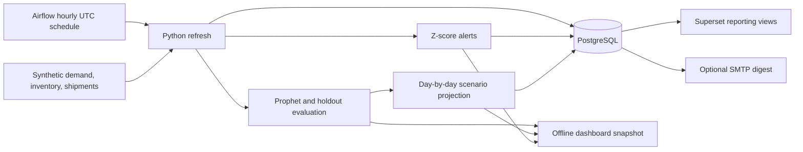

# Architecture and data contract

| PostgreSQL object | Grain | Contents |
|---|---|---|
| demand | SKU and completed UTC date | Units of unconstrained demand |
| inventory | SKU at current refresh | Supplier, on-hand quantity, inbound units and expected arrival date |
| shipments | Delivered shipment | Order, promised delivery and actual delivery date |
| inventory_hour | SKU and UTC hour | On-hand units over 168 observations |
| forecast | SKU and future UTC date | Nonnegative point demand forecast, starting on the current UTC date |
| product_kpi | SKU at current refresh | Inventory, seven-day demand, days of inventory, stock-out and supplier delivery KPIs |
| supplier_kpi | Supplier | Delivered shipment count, on-time rate and mean lead days |
| scenario / delay_panel | SKU and delay from 0 to 7 days | 14-day lost units, incremental loss versus baseline, first short day and ending stock |
| alert | SKU and triggered rule | Message for the current refresh |
| refresh / delivered_digest | UTC hour | Forecast method and WAPE / successful SMTP digest marker |

The transaction replaces the current snapshot and records the refresh hour. An advisory lock serializes writes, and an older run cannot replace a newer snapshot. SMTP runs after commit. A successful send is recorded per hour. A process failure between SMTP acceptance and the database commit can send a duplicate on retry.

## KPI definitions

- **Stock-out rate** is the share of observed SKU-hours with zero on hand over the last 168 observations.
- **On-time delivery** is the share of delivered shipments whose actual date is on or before the promised date.
- **Supplier lead time** is mean calendar days from order to receipt across delivered shipments.
- **Days of inventory** is on-hand stock divided by average forecast demand over the next seven days, excluding inbound.
- **Holdout WAPE** is total absolute forecast error divided by total actual units. The last 14 completed days are held out for all four SKUs. Final models refit on 84 days before forecasting.
- **Demand spike** triggers at a z-score of 3 against up to eight earlier observations on the same weekday. **Delivery delay** uses the latest receipt's lateness against the preceding 11 receipts. The standard-deviation floor is one unit or one day. **Low cover** triggers below two days.
- The what-if projection receives inbound before demand on the arrival date and treats shortages as lost sales. Day 1 represents the current UTC calendar date. It assumes a single inbound shipment and no additional replenishment during the horizon.

The hourly source is a synthetic snapshot generator. It illustrates ingestion and replay by timestamp. Inventory, shipments and demand are simulated independently and should be replaced with reconciled records for production.
